<div align="center">

# 🎓 LMS & EMS

### 🚀 Learn smarter. Examine fairly. Powered by AI.

An all-in-one **Learning Management System** and **Exam Management System** with AI-generated courses, video lessons, online exams, automatic grading and deep analytics.


</div>

---

## 📖 About

**LMS & EMS** is a complete education platform that brings teaching, learning and assessment into one place. Admins and instructors can build full courses in minutes using **Groq AI**, students can learn through videos, notes and quizzes, and institutions can run secure, timed online exams with instant results.

---

## 🤖 AI-Powered Features (Groq)

| Feature | Description |
|---------|-------------|
| 🪄 **Auto Course Generator** | Enter a topic and get a full course outline instantly |
| 📚 **Chapter & Module Builder** | AI creates chapters, modules and lesson content |
| ❓ **Q&A Section Generator** | Auto-generated questions and answers for every module |
| 📝 **AI Question Bank** | MCQ, true/false, short and long answer questions by difficulty |
| 🧠 **Smart Summaries** | Lesson summaries and quick revision notes |
| 💬 **AI Doubt Solver** | Students ask questions and get instant explanations |
| 🎯 **Difficulty Control** | Beginner, intermediate and advanced content generation |
| 🔁 **Regenerate & Edit** | Review, tweak or regenerate any AI-generated content |

---

## 🎬 Learning Features

- 🎥 **Video lessons** with progress tracking and resume playback
- 📄 **Notes, PDFs and downloadable resources**
- 🔗 **External links** and reference materials
- 📖 **Chapter-wise and module-wise** structured learning
- ✅ **Practice quizzes** after every module
- 🏆 **Course completion certificates**
- 📊 **Learning progress dashboard**
- 🔖 **Bookmarks** and personal notes
- 💬 **Discussion and Q&A** per lesson
- 🔔 **Notifications** for new content, exams and deadlines

---

## 📝 Exam Management Features

- 🗓️ **Schedule exams** with start time, end time and duration
- ⏱️ **Timed exams** with auto-submit
- 🔀 **Randomized questions and options**
- 🧩 **Multiple question types**: MCQ, multi-select, true/false, short and long answer
- 🤖 **Auto-grading** for objective questions
- ✍️ **Manual evaluation** for descriptive answers
- 🔒 **Secure exam mode**: attempt limits, single session, tab-switch detection
- 📈 **Instant results** with detailed score breakdown
- 🏅 **Rank lists and leaderboards**
- 📋 **Attendance tracking** for exams and classes
- 🔁 **Re-exam and retake** management
- 📥 **Export results** to PDF and Excel

---

## 👥 User Roles

### 🛡️ Admin
- Manage users, instructors, students and roles
- Manage courses, categories and batches
- Monitor exams, results and platform analytics
- Configure system settings

### 👨‍🏫 Instructor
- Create courses manually or with AI
- Upload videos, notes and materials
- Build question banks and schedule exams
- Evaluate answers and track student progress

### 🎓 Student
- Enroll in courses and learn through videos
- Take practice quizzes and online exams
- View results, certificates and progress
- Ask the AI doubt solver for help

---

## 🔄 How It Works

```mermaid
flowchart LR
    A[👨‍🏫 Instructor enters topic] --> B[🤖 Groq AI generates course]
    B --> C[📚 Chapters & Modules]
    C --> D[❓ Q&A + Question Bank]
    D --> E[🎥 Add videos & notes]
    E --> F[🎓 Students learn]
    F --> G[📝 Online exam]
    G --> H[📊 Auto-grading & Analytics]
    H --> I[🏆 Certificate]
```



---

## 🛠️ Tech Stack

| Layer | Technology |
|-------|------------|
| 🎨 Frontend | React + Vite |
| ⚙️ Backend | ASP.NET Core Web API (.NET) |
| 🗄️ Database | PostgreSQL |
| 🧠 AI Engine | Groq API (LLaMA models) |
| 🔐 Authentication | JWT |
| 🎯 Styling | CSS / Tailwind |

---

## 🚀 Getting Started

### ✅ Prerequisites

- Node.js 18+
- .NET SDK 8+
- PostgreSQL 14+
- Groq API key

### 1️⃣ Clone the repository

```bash
git clone https://github.com/akadta/LMS-EMS.git
cd LMS-EMS
```

### 2️⃣ Create the database

```sql
CREATE DATABASE lms_ems;
```

### 3️⃣ Configure the backend

Update `appsettings.json` (or use user-secrets):

```json
{
  "ConnectionStrings": {
    "DefaultConnection": "Host=localhost;Port=5432;Database=lms_ems;Username=postgres;Password=your_password"
  },
  "Jwt": {
    "Key": "your_super_secret_key",
    "Issuer": "lms-ems",
    "Audience": "lms-ems-users"
  },
  "Groq": {
    "ApiKey": "your_groq_api_key"
  }
}
```

Run migrations and start the API:

```bash
cd main-backend
dotnet ef database update
dotnet run
```

### 4️⃣ Start the frontends

```bash
# Admin panel
cd admin
npm install
npm run dev

# Student portal
cd user
npm install
npm run dev

# Main website
cd main
npm install
npm run dev
```

### 5️⃣ Open the apps

| App | URL |
|-----|-----|
| 🌐 Main site | http://localhost:5173 |
| 🛡️ Admin panel | http://localhost:5174 |
| 🎓 Student portal | http://localhost:5175 |
| ⚙️ API | https://localhost:5001 |

---

## 🔑 Get Your Groq API Key

1. Visit [console.groq.com](https://console.groq.com)
2. Sign up or log in
3. Create an API key
4. Add it to your backend configuration

---

## 🎯 Roadmap

- [x] User roles and authentication
- [x] Course, chapter and module management
- [x] AI course and Q&A generation
- [x] Video learning
- [x] Online exams with auto-grading
- [ ] Live classes integration
- [ ] AI-based exam proctoring
- [ ] Assignments and project submissions
- [ ] Payment gateway for paid courses
- [ ] Mobile app
- [ ] Multi-language support
- [ ] Gamification: badges and streaks

---

## 🤝 Contributing

Contributions are welcome!

1. 🍴 Fork the repo
2. 🌿 Create a branch: `git checkout -b feature/amazing-feature`
3. 💾 Commit: `git commit -m "Add amazing feature"`
4. 🚀 Push: `git push origin feature/amazing-feature`
5. 📬 Open a Pull Request

---

## 📄 License

Distributed under the **MIT License**.

---

<div align="center">

### ⭐ If you like LMS & EMS, give it a star!

Made with ❤️ by [akadta](https://github.com/akadta)

</div>
